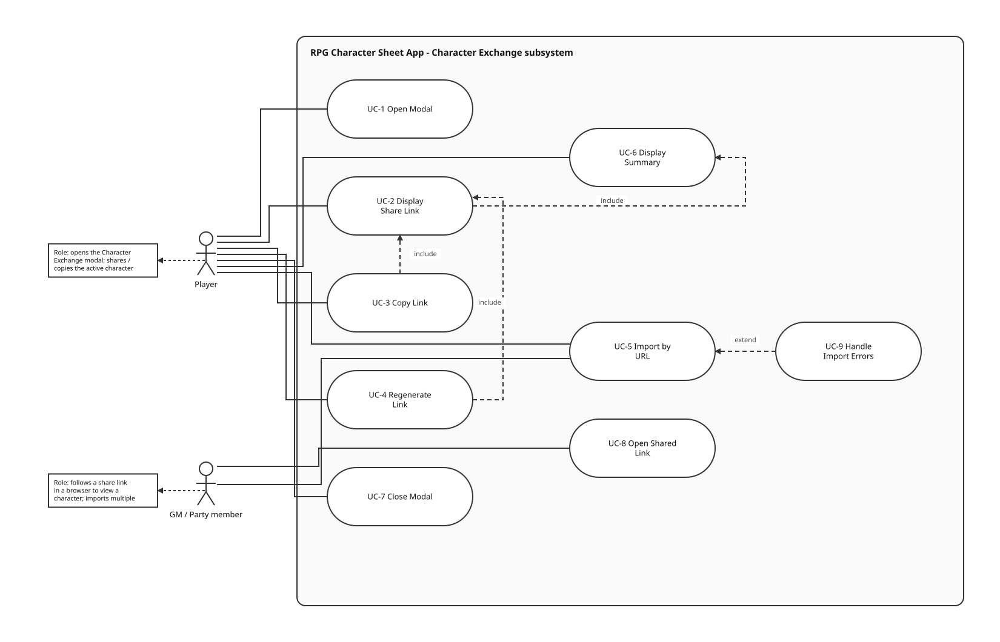
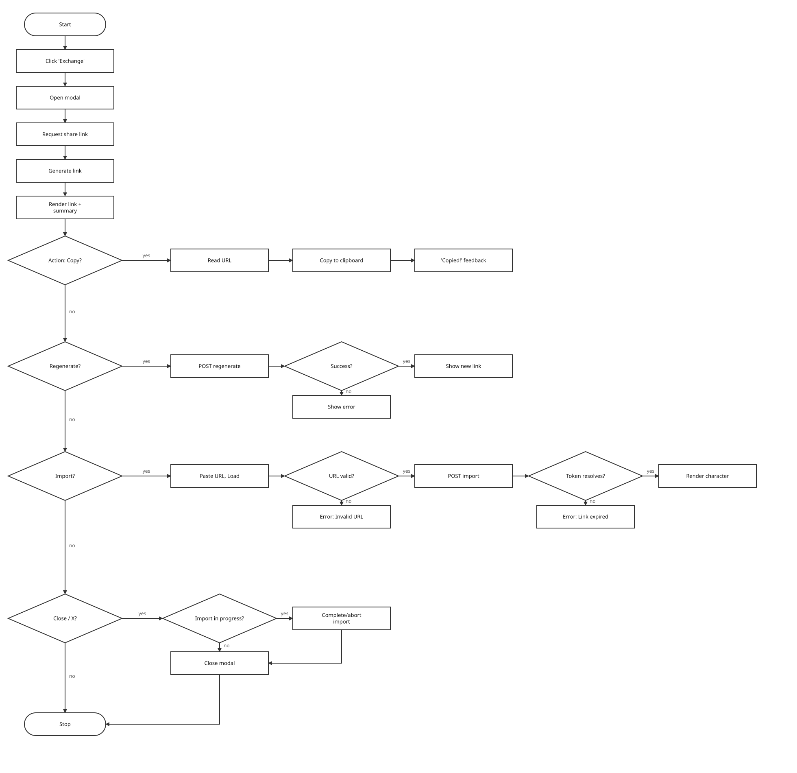
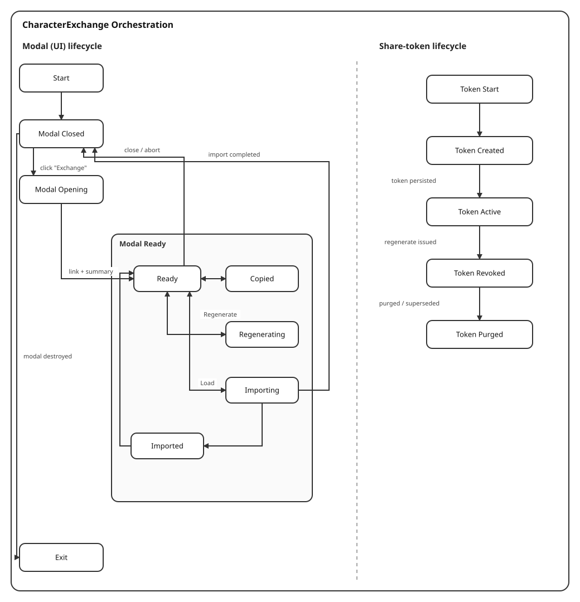
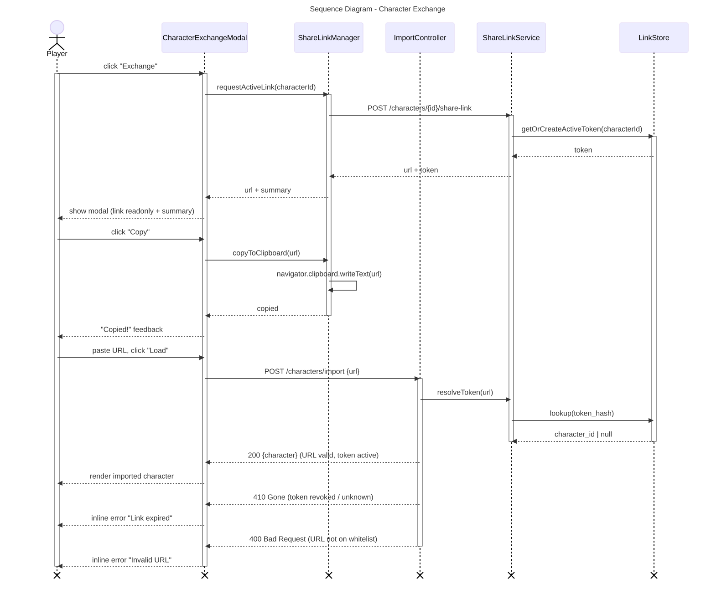

# UML Dynamic-Behavior Model — Character Exchange Feature

Model of the dynamic behavior of the **Character Exchange** feature of the RPG Character
Sheet Application (target v1.2), produced from the documentation (`srs/`, `sdd/`, `adr/`).

The diagrams are maintained as **textual UML / Mermaid sources** (`.mmd`) and rendered to
**committed SVG images** (`.svg`). The SVGs are what GitHub shows (they are embedded in this
README and in the SDD), so the pushed documentation renders **exactly** the curated diagrams
(right-angled connectors, aligned composite borders, activation bars, end crosses, etc.).
Mermaid cannot reproduce those hand-tuned layouts, which is why the rendered SVG is committed
alongside the source.

## Contents

| File | Content |
|------|---------|
| `glossary.md` | Project glossary — tabular, standalone artifact. |
| `supplementary-spec.md` | Additional / supplementary (non-functional, global) specifications. |
| `use-case-spec.md` | Actor descriptions (1–2 lines) and use-case descriptions (explanation, preconditions, flows, postconditions). |
| `use-case-diagram.mmd` | Use-Case diagram source (Mermaid). Rendered → `use-case-diagram.svg`. |
| `activity-diagram.mmd` | Activity diagram source (textual description). Rendered → `activity-diagram.svg`. |
| `state-diagram.mmd` | State Machine diagram source (Mermaid). Rendered → `state-diagram.svg`. |
| `sequence-diagram.mmd` | Sequence diagram source (Mermaid). Rendered → `sequence-diagram.svg`. |
| `class-diagram.svg` | Class diagram (reference UML style). Generated by `gen-class-svg.mjs`. |
| `component-diagram.svg` | Component diagram (subsystems, ports, interfaces). Generated by `gen-component-svg.mjs`. |
| `deployment-diagram.svg` | Deployment diagram (artifacts, folders, manifest). Generated by `gen-deployment-svg.mjs`. |
| `*.svg` | The committed rendered diagrams embedded below (what GitHub displays). |
| `gen-*.mjs` | Layout generators (activity / state / use-case / class / component / deployment). |
| `uml-style.mjs` | Shared UML drawing helpers (class/component/artifact shapes, ports, interfaces). |
| `fix-sequence-svg.mjs` | Post-processor for the sequence render (lifelines, activation, crosses). |
| `render-all.sh` | Regenerates all SVG files. |
| `README.md` | This overview, render instructions, and traceability. |

## Diagrams

### Use-Case



### Activity



### State Machine



### Sequence



### Class


### Component


### Deployment


Actor and use-case descriptions are in [`use-case-spec.md`](use-case-spec.md); vocabulary is in
[`glossary.md`](glossary.md) and [`supplementary-spec.md`](supplementary-spec.md).

## How to render / regenerate

Regenerate all committed SVGs in one command:

```sh
./render-all.sh
```

This writes `use-case-diagram.svg`, `activity-diagram.svg`, `state-diagram.svg` and
`sequence-diagram.svg` in this folder, and re-run it after editing any `.mmd` or generator.

For ad-hoc previews the individual scripts are also available:
`render-usecase.sh`, `render-activity.sh`, `render-state.sh`, `render-sequence.sh`.

> Why committed SVGs? Mermaid (Dagre/ELK) cannot guarantee the required geometry — right-angled
> connectors, no crossings, aligned composite-border entry/exit, activation rectangles, end
> crosses. The generators in this folder produce exact SVG, which is committed and embedded so
> GitHub renders it identically. The `.mmd` files remain the editable textual sources.

## How the model was built

1. **Actors & use cases** were derived from the SRS (`srs/project-srs-en.md`):
   REQ-FUNC-001 … REQ-FUNC-005, REQ-SEC-001, and the requirements doc (`srs/project-req-en.md`).
2. **Dependencies between use cases** (the `include`/`extend`) mirror the runtime flows in
   SDD DV-004 (Interaction) — e.g. *Copy* includes *Display Share Link*, *Display Share Link*
   includes *Display Character Summary*.
3. **Activity** and **State** diagrams instantiate SDD DV-005 (State Dynamics) and DV-004.
4. **Sequence** diagram maps directly to the API contracts in SDD DV-003 (Interface) and the
   components of DV-002 (Composition: `CharacterExchangeModal`, `ShareLinkManager`,
   `ImportController`, `ShareLinkService`, `LinkStore`).

## Traceability

| UML artifact | SDD design element | SRS / ADR |
|--------------|--------------------|-----------|
| Use-Case diagram | DV-001 Context, DV-003 Interface | REQ-FUNC-001…005, REQ-SEC-001 |
| Activity diagram | DV-004 Interaction | REQ-FUNC-001…005 |
| State diagram | DV-005 State Dynamics | REQ-FUNC-002, REQ-FUNC-005, ADR-001 |
| Sequence diagram | DV-004 Interaction, DV-003 Interface | REQ-FUNC-002, REQ-FUNC-004, REQ-SEC-001 |

Glossary and supplementary specifications feed SDD §1.3 (Definitions) and the quality/security
attributes; see `sdd/project-sdd-en.md` and `adr/project-adr-en.md`.